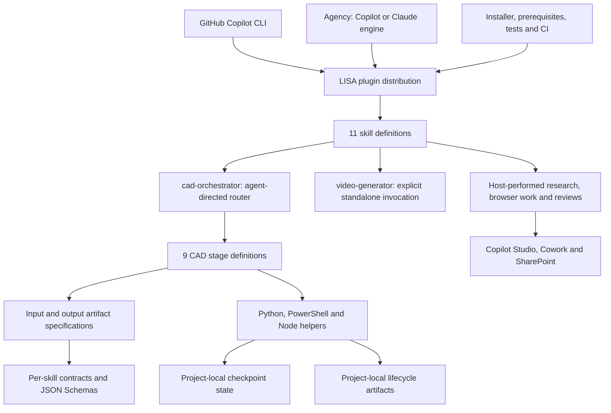
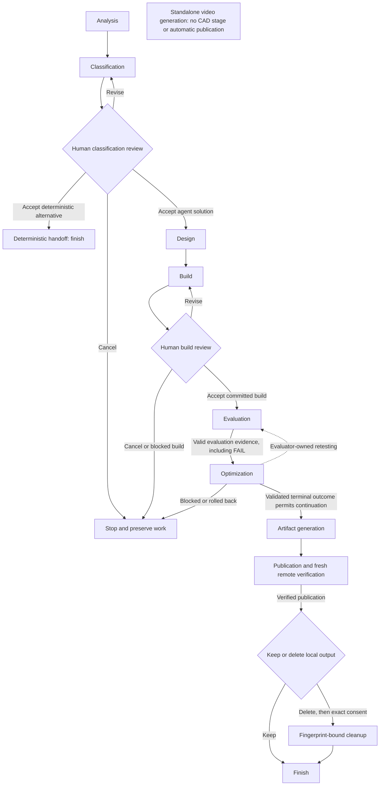
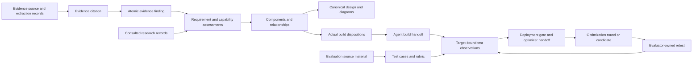

# LISA Copilot architecture and domain ontology

## Scope and interpretation

This is a source-backed model of the LISA distribution for **GitHub Copilot CLI and
Microsoft Agency**, including its directly related installer, configuration, prerequisites,
tests, and CI. Other distributions are outside this model.

Reviewed on **2026-11-10** against repository revision
`947a64b313799b20da7190d623ebb724d170237b`.

- [lisa-ontology.jsonld](lisa-ontology.jsonld) is the machine-readable ontology: an inline
  JSON-LD 1.1 context, RDFS classes and properties, architecture individuals, and source references.
- This document explains the model, important execution boundaries, and review findings.
- [test_ontology.py](../tests/test_ontology.py) checks graph integrity, source locations,
  current skill/contract/stage coverage, and documentation links.

The ontology describes **what the repository implements or instructs**, not current Microsoft
product capabilities or a successfully deployed customer solution. No customer records, tenant
identities, credentials, or example deployment results are instantiated. This was an architectural
review with local verification, not an exhaustive security audit or live-cloud test.

Identifiers use `urn:lisa:copilot:ontology:` (prefix `lisa:`). These are stable identifiers,
not service endpoints. The graph is descriptive, not an executable workflow, a replacement for
the packaged JSON Schemas, or an OWL/SHACL constraint system.

## 1. Architecture



Three distinctions prevent misleading interpretations:

1. **Execution host is not delivery target.** GitHub Copilot CLI runs LISA; the GitHub Copilot
   *harness* is one possible runtime of an agent built in Copilot Studio. Agency's Copilot/Claude
   engines are another, separate concept. See [plugin manifest](../plugin.json),
   [Agency metadata](../agency.json), and [builder platform registry](../skills/agent-builder/SKILL.md#L20).
2. **Skill is not script.** A skill can combine model-authored decisions, deterministic helpers,
   browser operations, and human decisions. No packaged executable runs the entire CAD route;
   the [orchestrator instructions](../skills/cad-orchestrator/SKILL.md#L8) direct the host.
3. **Definition is not run.** The graph contains skill/stage definitions and artifact
   specifications. `WorkflowRun`, `StageRun`, `AgentIdentity`, and other domain classes describe
   possible runtime data; the ontology does not invent instances of those customer objects.

## 2. Lifecycle and artifact ownership

The normal route below describes Copilot Studio delivery. Its transitions are host instructions,
not a state machine enforced by the checkpoint module. Cowork-only delivery has the limitation
recorded in [review finding R2](#r2-cowork-build-support-does-not-imply-end-to-end-cad-support).



The retest edge denotes reuse of the evaluator skill. In particular, GEPA candidate evaluations
do **not** start or commit a top-level evaluation stage; their request/candidate cursor remains
within optimization ([routing policy](../skills/cad-orchestrator/SKILL.md#L117)).
Invalid artifacts, execution failures, and unmet stage gates stop advancement even where the
diagram omits a failure edge.

All paths below are relative to the configured project `basePath`, not the installed plugin.
Completion markers are **roles assigned to artifacts**, not proof that every gate was enforced
by the same program.

| Stage | Owning skill | Main information produced | Completion marker |
|---|---|---|---|
| Analysis | [requirement-analyzer](../skills/requirement-analyzer/SKILL.md) | Source-grounded findings, evidence ledger, readable analysis | `output/analysis/requirement-analysis_<timestamp>-manifest.json` |
| Classification | [complexity-classifier](../skills/complexity-classifier/SKILL.md) | Suitability, platform/harness, capabilities, coverage, full solution topology | `output/classification/classification-manifest.json`, then human acceptance |
| Design | [solution-designer](../skills/solution-designer/SKILL.md) | Canonical design model, Business/Engineering/Sequence diagrams, review page and inspection evidence | `output/design/current-design.json` |
| Build | [agent-builder](../skills/agent-builder/SKILL.md) | Agent identity, actual component dispositions, instructions, package/configuration evidence, evaluator handoff | `output/build/build-manifest.json`, then human acceptance |
| Evaluation | [agent-evaluator](../skills/agent-evaluator/SKILL.md) | Dataset, rubric, observations, baseline, deployment decision and optimizer handoff | `output/evaluation/evaluation-manifest.json` |
| Optimization | [agent-optimizer](../skills/agent-optimizer/SKILL.md) | Instruction audit, plan, round snapshots, changes, retest/rollback evidence; optional GEPA results | `output/optimization/optimization-manifest.json` |
| Artifacts | [artifact-generator](../skills/artifact-generator/SKILL.md) | Customer document, execution tree, available diagram copies | `output/artifacts/artifact-generation-manifest.json` |
| Publication | [artifact-publisher](../skills/artifact-publisher/SKILL.md) | Selected upload manifest, remote inventory and publication history | `output/publication/publication-record.json` |
| Cleanup, optional | [postpublish-cleanup](../skills/postpublish-cleanup/SKILL.md) | Removal of consented output contents; preserved empty output root | External active-stage checkpoint under `.lisa`, not a file in `output` |

`cad-orchestrator` owns routing, not another stage output folder.
[video-generator](../skills/video-generator/SKILL.md#L1) is the eleventh skill, explicitly
invoked and outside CAD. Its contract category is `video`; its production outputs include MP4,
captions, thumbnails, timing and verification files. It has no CAD completion marker.

**Contract category, workflow stage, and status are not interchangeable.**
The common contract schema recognizes `orchestration` and `video`, while the
[checkpoint stage registry](../skills/workflow_checkpoint.py#L23) contains only the nine stages
above. Publication's contract names `publication-manifest.json`, but the orchestrator commits
`publication-record.json`. The ontology models those as different artifacts.

## 3. Domain vocabulary

The following are classes, not fabricated customer records. Exact property definitions and
source references are in [the JSON-LD graph](lisa-ontology.jsonld).

| Domain | Principal classes | Meaning |
|---|---|---|
| Distribution | `Distribution`, `ExecutionHost`, `HostEngine`, `Skill`, `RuntimeModule`, `Prerequisite`, `TestSuite` | How LISA is packaged, hosted, implemented and checked |
| Lifecycle | `WorkflowDefinition`, `StageDefinition`, `WorkflowRun`, `StageRun`, `Checkpoint`, `CompletedStageRecord` | Static route versus a particular execution and its durable position |
| Artifact interface | `ArtifactSpec`, `Artifact`, `Manifest`, `ArtifactContract`, `JsonSchema` | Named artifact families, actual data, inventories, declarations and validators |
| Project inputs | `ProjectConfig`, `EvidenceSource`, `ExtractionRecord`, `ReviewBatch`, `ReviewReceipt` | Config authority, file/config/corpus evidence and bounded review units |
| Analysis | `EvidenceLedger`, `EvidenceFinding`, `EvidenceCitation` | Atomic findings and their traceable support, not design recommendations |
| Classification/design | `RequirementAssessment`, `CapabilityAssessment`, `ClassificationResult`, `SolutionTopology`, `TopologyComponent`, `TopologyRelationship`, `DesignModel`, `ResearchRecord` | Full desired architecture and grounded platform/buildability decisions |
| Construction | `BuildHandoff`, `BuildDisposition`, `AgentIdentity`, `DeployablePackage`, `DeliveryPlatform`, `Harness` | What was actually built/configured versus simulated, manual, deferred or blocked |
| Evaluation | `EvaluationDataset`, `EvaluationRubric`, `EvaluationObservations`, `TestCase`, `TestObservation`, `Gate` | Source-grounded test inputs, recorded behavior and deployment decisions |
| Optimization | `OptimizationPlan`, `OptimizationRound`, `Candidate` | Justified changes, before/after/rollback state and candidate instruction variants |
| External changes | `RemoteOperationIntent`, `RemoteReceipt`, `PublicationManifest`, `PublicationRecord`, `ConsentInventory` | Intended remote writes, verified outcomes, publication evidence and bounded cleanup scope |
| Knowledge about the code | `SourceReference`, `ReviewFinding`, `EnforcementLevel`, `StatusVocabulary`, `Transition`, `Outcome` | Provenance, limitations, enforcement distinctions and conditional routing |



This diagram summarizes information flow, not a guarantee of a common foreign key across every
schema. For example, evaluation cases have source references; the model does not invent a
mandatory capability-ID field in the evaluation dataset.

### Important semantic distinctions

- **Evidence versus research:** analysis accepts requirement-file and configured-source evidence;
  classification adds consulted capability/product research. Configuration URLs are not proof
  that their contents were fetched. See [analysis boundaries](../skills/requirement-analyzer/SKILL.md#L29)
  and [classifier research requirements](../skills/complexity-classifier/SKILL.md#L63).
- **Desired topology versus actual build:** classification describes the whole solution.
  Build dispositions separately record `built`, `configured`, `simulated`, `manual`, `deferred`,
  `blocked`, `failed`, or `not-applicable`
  ([handoff schema](../skills/agent-builder/resources/agent-build-handoff.schema.json#L197)).
- **Complexity versus coverage:** complexity is not the fraction LISA can build. Native and
  PoC-demonstration coverage are separately computed as business-weighted sums of capability
  factors divided by total business weight
  ([coverage computation](../skills/complexity-classifier/scripts/complexity_classifier.py#L3005)).
- **Platform versus harness:** only Copilot Studio has `Standard`, `GitHub Copilot`, and
  `Copilot chat` harnesses. Cowork requires `harness: null`. Foundry and Agent Framework are
  architecture/research options and deferred integration targets, not implemented builder paths
  ([platform boundary](../skills/Platform-Decision.md#L25)).
- **Execution success versus test success:** a well-formed evaluation with decision `FAIL` is
  valid evidence for optimization. It is not the same as a missing or invalid evaluation.
- **Search improvement versus target improvement:** GEPA uses host-serviced requests, bounded
  budgets, a shadow agent and frozen evaluation data. A selected candidate is not a successful
  target deployment. The runtime verifies final target identity, instruction hash, unchanged
  dataset/rubric/baseline and protected tests before reporting measured impact
  ([outcome validation](../skills/gepa_runtime.py#L646)).

### Core relations

Architecture relations include `hostedBy`, `supportsEngine`, `performsStage`, `stageOrder`,
`artifactContract`, `consumes`, `produces`, `completionMarker`, `implementedBy`, `validatedBy`,
`conformsTo`, `requiresGate`, `supportsTarget`, `hasHarness`, `retestsWith`, and `testedBy`.
`consumes` and `produces` describe possible information flow, not universal requiredness:
consult the contracts and node descriptions for optional inputs and build-mode-dependent outputs.
For example, video may use an existing build handoff without making a build prerequisite.

Runtime-domain relations include `hasFinding`, `hasEvidence`, `citesSource`, `addressesFinding`,
`hasComponent`, `connectsComponent`, `reconcilesComponent`, `hasTestCase`, `observationOf`,
`hasRound`, `recordsOperation`, and `verifiedByReceipt`. RDFS domains/ranges describe their
meaning; packaged schemas and semantic validators remain the actual runtime constraints.

## 4. Enforcement and recovery boundaries

The graph uses three evidence-backed enforcement levels:

- `code`: a packaged program performs the described check or operation.
- `schema`: a packaged JSON Schema constrains the described data.
- `agent-directed`: the host must perform the instructed action or judgment.

A skill can have several levels because its different responsibilities are implemented
differently. These annotations do not mean every sentence in a skill is programmatically enforced.

| Boundary | What is enforced | What remains host-owned |
|---|---|---|
| Config and paths | Config filename, existing base directory, canonical child paths and containment checks in [path resolver](../skills/lisa_path_resolver.py#L85) | Selecting the intended project and supplying real tenant configuration |
| Analysis handoff | Matching ledger/Markdown siblings, source-root/run binding and SHA-256 checks; invalid newest analysis is rejected in [handoff loader](../skills/analysis_handoff.py#L129) | Understanding evidence; review receipts record declarations, not proof of comprehension |
| Contract definitions | Contract shape, skill identity, lowercase root, schema references and regex validity in [contract validator](../skills/validate_artifact_contracts.py#L32) | Running the stage-specific output validator; definition validation is not output validation |
| Design publication | Schema, staged artifacts, inspection checks and hash-bound current pointer in [designer finalization](../skills/solution-designer/scripts/solution_designer.py#L2980) | Honest visual assessment and browser evidence collection |
| Classification/build approval | Checkpoint can persist `WAITING` | Asking the human, honoring Accept/Revise/Cancel, and committing only after acceptance |
| Evaluation | Exact test/result coverage, evidence requirements and aggregate gate checks in [evaluation renderer](../skills/agent-evaluator/scripts/render_evaluation.py#L72) | Executing actual tests and authoring truthful observations/judgments |
| Remote operations | Checkpoint stores intent/receipt and recovery exposes reconciliation in [checkpoint code](../skills/workflow_checkpoint.py#L312) | Issuing the write, verifying live identity/state, and reconciling uncertainty |
| Publication | Manifest/package checks, two-phase REST transport and remote-inventory comparison in [publication guard](../skills/artifact-publisher/scripts/publication-guard.ps1#L529) and [REST runner](../skills/artifact-publisher/scripts/fast-sharepoint-publisher.js#L1) | Authenticated browser context and fresh inventory collection; the guard compares supplied inventory rather than independently signing in |
| Cleanup | Exact phrase, inventory fingerprint, reparse-point checks and empty-root verification in [cleanup engine](../skills/postpublish-cleanup/scripts/cleanup_output.py#L228) | Obtaining actual human consent and requiring verified publication before offering cleanup |

### Durable state

Project data and runtime state have separate lifetimes:

```text
<basePath>\
  requirements\
  evalData\
  output\
    analysis\ classification\ design\ build\
    evaluation\ optimization\ artifacts\ publication\
    video\                      optional, independent productions
  .lisa\
    current.json                current workflow pointer, with fallback slots
    runs\<workflowRunId>\
      workflow.a.json           alternating workflow snapshots
      workflow.b.json
      active-stage.json         phase/unit, intent and latest receipt
      active-stage.a.json        fallback stage snapshots
      active-stage.b.json
      events.ndjson
```

The [checkpoint implementation](../skills/workflow_checkpoint.py#L88) uses atomic replacement,
integrity hashes, generation selection and a lock. Recovery reads fixed pointer/snapshot locations
and returns `continue-phase` or `reconcile-remote-operation`; it does not scan output trees.

`complete_stage` checks the marker's containment, existence and hash, but **does not validate the
marker's stage schema, prove human approval, or enforce predecessor completion**. `start_stage`
also does not enforce stage order. Those obligations belong to the owning skill and router
([start/complete logic](../skills/workflow_checkpoint.py#L271)).

Keep status vocabularies separate:

- Workflow: `RUNNING`, `WAITING`, `RECONCILING`, `COMPLETED`, `BLOCKED`, `FAILED`, `CANCELLED`.
- Recorded stage completion: `COMMITTED` or `BLOCKED`.
- Test/deployment decisions: `PASS`, `FAIL`, `BLOCKED`, `NOT_RUN`.
- Per-skill contract statuses retain their own case and meaning, such as `validated`, `complete`,
  `pass`, `fail`, `rolled-back`, and `PUBLISHED`.

Cleanup's fingerprint binds the resolved root, directory names, and file names/sizes/mtime values;
it is **not a content-hash inventory**
([inventory algorithm](../skills/postpublish-cleanup/scripts/cleanup_output.py#L177)).
Cleanup removes output contents, not `.lisa` or remote resources.

## 5. Integrations and repository infrastructure

The [MCP configuration](../.mcp.json) declares Playwright, Azure MCP, Microsoft Learn,
Microsoft IcM, and Engineering Hub. These are configuration-level integrations, not proof that
authentication, tenant access or a service is available. Internal research must remain out of
customer artifacts ([integration guidance](../README.md#L406)).

PAC CLI and authenticated browser actions support cloud stages. SharePoint has distinct
destinations: the deployable ZIP at the Agent Library root, and Agent-ID-linked files in the
Agent Artifact library's agent-name folder. The ontology does not equate uploaded evidence with
a customer-facing deliverable ([publication categories](../skills/artifact-publisher/SKILL.md#L36)).

Related infrastructure:

- [Root installer](../../Install-LISA-Prerequisites.ps1#L709): registers the selected Copilot/Agency
  host; project initialization is optional and preserves existing configuration and data.
- [Runtime probe](../scripts/Get-LisaRuntimePrerequisites.ps1#L1) and
  [packaged prerequisite checker](../scripts/Test-LisaAgencyPrerequisites.ps1): Python 3.11+,
  Node.js 20+/npm/npx, PowerShell 7+, and capability-specific prerequisites.
- [Root requirements](../../requirements.txt) and [packaged requirements](../requirements.txt):
  shared base dependencies; GEPA and video dependencies are optional, not part of the base set.
- [Example configuration](../lisa-config.example.json): common project configuration shape.
  [Parity tests](../tests/test_plugin.py#L155) compare the root and packaged config semantically.
- [Repository test runner](../../scripts/Test-LisaRepository.ps1#L24) and
  [CI workflow](../../.github/workflows/ci.yml#L15): local Python/Node/renderer suites; these are
  not certification of live tenant operations.

The designer uses the packaged Python/NetworkX layout and Node/resvg rendering path.
Video uses a separately initialized production folder, canvas/FFmpeg and an approved narration
service. Neither output production should write into the installed plugin.

## 6. Review findings and modeling limits

### R1: Builder CLI entry points bypass the builder-specific reconciliation wrapper

**High-confidence correctness finding; not fixed by this documentation change.**

The imported builder [validator wrapper](../skills/agent-builder/scripts/validate_artifacts.py#L140)
and [manifest wrapper](../skills/agent-builder/scripts/generate_manifest.py#L22) call
`validate_classification_reconciliation`. That checks classified component coverage, planned
coverage and future-platform contracts. Their `__main__` paths instead invoke shared CLI helpers.
Those helpers call the shared lifecycle functions directly
([shared CLI implementation](../skills/lifecycle_artifacts.py#L608)).

**Local reproduction:** created the existing builder unit-test fixture in a temporary directory,
published a valid manifest, then added an unreconciled component to its referenced classification.
The imported validator rejected the missing component; running the packaged validator as a CLI
returned exit code `0` and `status: passed` for the same fixture. The temporary directory was removed.
This tests local validation wiring, not a remote build.

Consequently, the ontology does not describe classifier reconciliation as an unconditional CLI
guarantee. A follow-up fix should wire both CLI paths through the builder wrappers and add
subprocess-level regression coverage.

### R2: Cowork build support does not imply end-to-end CAD support

**Confirmed contract/routing mismatch; no live Cowork execution was attempted.**

[Cowork's build path](../skills/agent-builder/resources/build-path-cowork.md#L5) and
[handoff schema](../skills/agent-builder/resources/agent-build-handoff.schema.json#L330)
permit a configuration build with `harness: null` and no package.
The [evaluation schema](../skills/agent-evaluator/resources/evaluation-observations.schema.json#L23)
requires one of the three Copilot Studio harnesses, while the
[publisher](../skills/artifact-publisher/scripts/publication-guard.ps1#L220) rejects a handoff with
no package. The [router](../skills/cad-orchestrator/SKILL.md#L90) provides a deterministic-no-agent
exit, but no equivalent explicit Cowork-only handoff branch.

Model Cowork as a supported **build/configuration target**, not a proven full delivery route.
A follow-up needs an explicit Cowork terminal handoff or compatible evaluation/publication
contracts and routing; the ontology intentionally does not invent that implementation.

### Other limits preserved in the model

- File recency is not one global policy. The [shared selector](../skills/lisa_path_resolver.py#L122)
  uses mtime plus filename; the [publisher](../skills/artifact-publisher/scripts/publication-guard.ps1#L368)
  uses filename ordering for some direct-child outputs. Current pointers/manifests have separate roles.
- The design contract's fixed-file list is not a complete description of actual diagram output:
  the [designer](../skills/solution-designer/scripts/solution_designer.py#L2997) also publishes the
  Business Architecture representation. The ontology records all three diagram kinds.
- JSON Schemas and hashes establish structural consistency, not truth of supplied observations,
  real human consent, product availability, or successful remote side effects.

## 7. Querying and maintaining the ontology

The JSON-LD context is local and self-contained. RDF consumers can load the file without fetching
a remote context. For example, this SPARQL query returns producers and consumers of the build
handoff:

```sparql
PREFIX lisa: <urn:lisa:copilot:ontology:>
PREFIX rdfs: <http://www.w3.org/2000/01/rdf-schema#>
SELECT ?producerName ?consumerName
WHERE {
  ?producer lisa:produces lisa:artifact-build-handoff ; rdfs:label ?producerName .
  ?consumer lisa:consumes lisa:artifact-build-handoff ; rdfs:label ?consumerName .
}
```

Questions the model supports:

1. Which skill owns a stage and its completion marker?
2. Which consumers depend on an artifact or shared helper?
3. Which controls are code-enforced versus host-directed?
4. Which delivery targets and harnesses are distinct from LISA's execution hosts?
5. Why is a valid failed evaluation different from a failed stage execution?
6. Which source files support a claim, and which known review limitations qualify it?

Run the dependency-free ontology checks from the repository root:

```powershell
python -m unittest discover -s .\github-copilot\tests -p test_ontology.py -v
```

The existing Plugin suite discovers these tests automatically. They check this repository's
compact JSON-LD profile; they are not a general RDF reasoner.

When changing a skill, contract, checkpoint stage, or integration, update the corresponding graph
individual, source references and diagrams together. Preserve stable identifiers unless meaning
changes. Update the reviewed revision only after rechecking the evidence. Never convert a roadmap,
instruction, mocked observation, or untested cloud action into an implemented fact.
